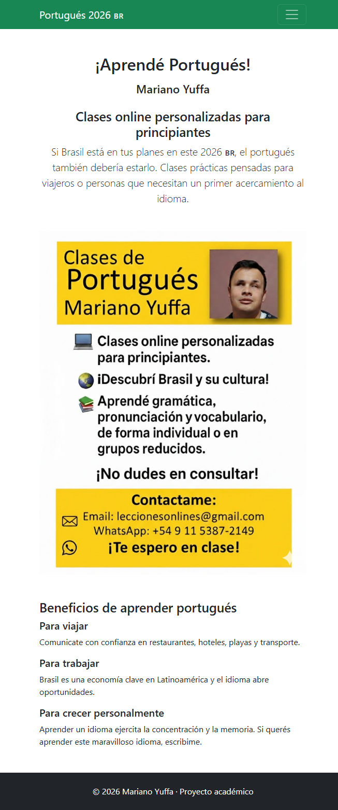
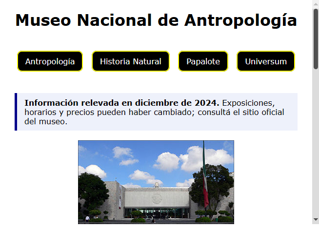

# Portfolio de desarrollo web

Portafolio académico de Mariano Yuffa que reúne sitios estáticos creados para practicar y mostrar trabajos de desarrollo web con HTML, CSS y Bootstrap.

[Ver portfolio publicado](https://marianoyuffa.github.io/proyectos-finales-web/)

## Proyectos

### Clases de portugués

Sitio multipágina para presentar clases online de portugués para principiantes, su metodología y los medios de contacto.

- **Sitio:** [Abrir proyecto](https://marianoyuffa.github.io/proyectos-finales-web/Clases/index.html)
- **Archivos:** [`Clases`](Clases)
- **Tecnologías:** HTML5 y Bootstrap 5.3.2
- **Incluye:** navegación adaptable, carrusel, pestañas de metodología y formulario de contacto.
- **Nota:** el formulario es demostrativo y no envía datos.

### Museos de Ciudad de México

Guía multipágina del Museo Nacional de Antropología, el Museo de Historia Natural, el Papalote Museo del Niño y Universum.

- **Sitio:** [Abrir proyecto](https://marianoyuffa.github.io/proyectos-finales-web/ProyectoMuseos/index.html)
- **Archivos:** [`ProyectoMuseos`](ProyectoMuseos)
- **Tecnologías:** HTML5 y CSS3
- **Incluye:** navegación entre museos, diseño adaptable e imágenes con texto alternativo.
- **Nota:** los datos sobre exposiciones, horarios y precios se relevaron en diciembre de 2024; conviene consultar los sitios oficiales antes de una visita.

## Ver los proyectos localmente

No hace falta instalar dependencias ni ejecutar un servidor. Descarga o clona el repositorio y abre `index.html` en un navegador para ver el portfolio. También puedes abrir directamente `Clases/index.html` o `ProyectoMuseos/index.html`. El proyecto de Clases carga Bootstrap desde un CDN, por lo que requiere conexión a Internet para mostrar todos sus estilos y componentes.

## Accesibilidad

Los proyectos aplican prácticas básicas de accesibilidad, revisadas con el lector de pantalla NVDA:

- Enlace para saltar al contenido principal en todas las páginas.
- Estructura semántica, encabezados ordenados y texto alternativo para las imágenes.
- Etiquetas asociadas a los campos de los formularios.
- Foco visible para navegar con teclado.

Es un trabajo en progreso; los sitios no cuentan con una auditoría de conformidad WCAG.

## Contacto

- [Email](mailto:marianonicolas@live.com)
- [LinkedIn](https://linkedin.com/in/marianoyuffa)
- [GitHub](https://github.com/marianoyuffa)
